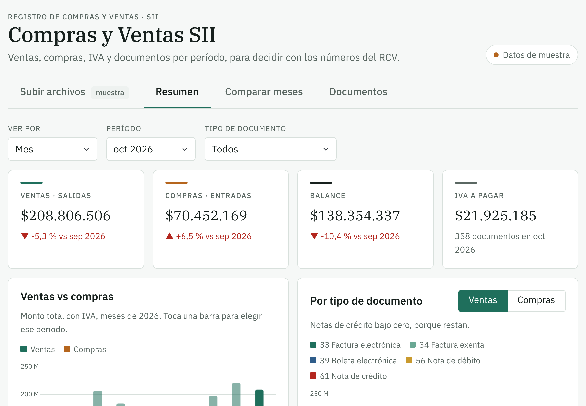
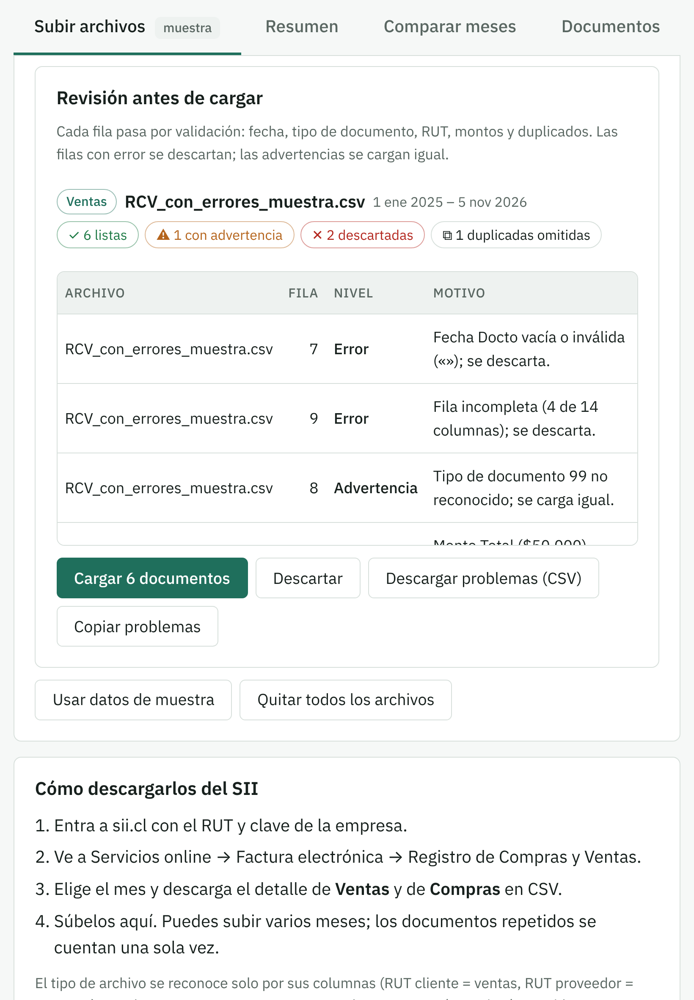
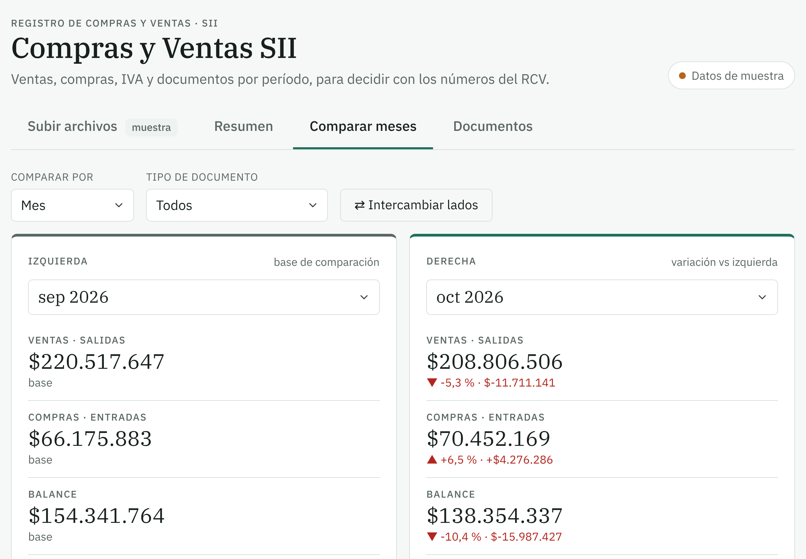
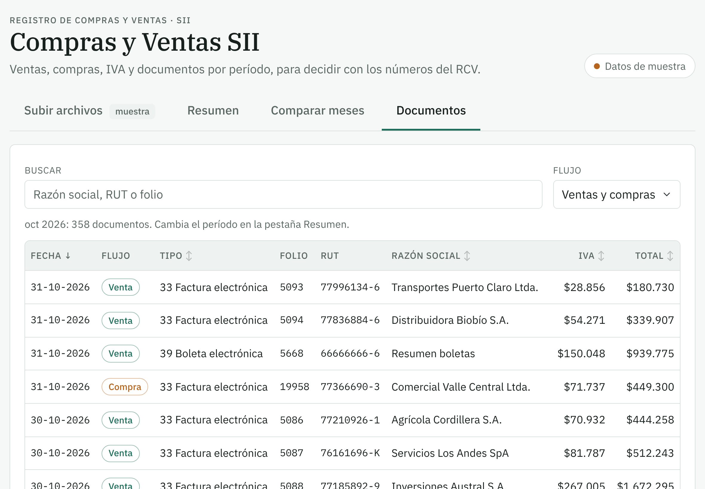

# ComprayVentaSII · Dashboard de Compras y Ventas SII

**[Ver demo en vivo →](https://compraventasii.vercel.app)** (abre con datos de muestra)


Dashboard para el gerente basado en el **Registro de Compras y Ventas (RCV)** del SII de Chile. Se suben los CSV de ventas y compras y se analizan por día, mes, trimestre o año, por tipo de documento, comparando meses.



## Problema → Solución → Resultado

| | |
|---|---|
| **Problema** | El SII entrega el Registro de Compras y Ventas como CSV sueltos por mes. Para ver ventas, compras e IVA por período o comparar dos meses hay que armarlo a mano en planillas, y una fila mala distorsiona los totales sin aviso. |
| **Solución** | Una app web instalable en tablet: se arrastran los CSV del RCV, cada fila se valida antes de cargarse y las cifras quedan listas por período, tipo de documento y cliente o proveedor. |
| **Resultado** | Ventas, compras, balance e IVA a pagar en una sola pantalla, comparación lado a lado entre períodos y un reporte de qué filas se descartaron y por qué. Los datos nunca salen del navegador. |

<details>
<summary><b>English summary</b></summary>

Sales and purchases dashboard for SME managers in Chile, built on the tax authority's (SII) Purchase and Sales Registry exports. Users drop in CSV files; every row goes through an ETL validation step (dates, document types, Chilean tax IDs with check digit, amounts, duplicates) before loading. The app shows sales, purchases, balance and VAT payable by day, month, quarter or year, compares any two periods side by side, and runs as an installable tablet-first PWA. All processing happens in the browser; no data is sent to a server. Static site deployed on Vercel.

</details>

## Capturas

| Validación antes de cargar | Comparar períodos |
|---|---|
|  |  |

| Documentos |
|---|
|  |

## Funciones

- **Subir archivos** con proceso ETL: arrastrar o elegir varios CSV del RCV, revisarlos y confirmar la carga.
  - *Extracción*: UTF-8 o Windows-1252, separador `;` o `,`, encabezado aunque venga después de líneas de título.
  - *Validación por fila*: fecha válida, tipo de documento, RUT con dígito verificador, folio, total vacío o menor que neto + exento + IVA, fechas futuras, filas incompletas, filas de totales.
  - *Reporte*: filas listas, con advertencia, descartadas y duplicadas omitidas, con número de fila y motivo; se puede descargar o copiar.
  - *Carga*: solo después de confirmar; las filas con error se descartan y las advertencias se cargan.
- **Resumen**: ventas, compras, balance e IVA a pagar con variación vs el período anterior; gráfico ventas vs compras; composición por tipo de documento; top 5 clientes y proveedores.
- **Comparar**: período izquierdo vs derecho, lado a lado (día, mes, trimestre o año). Las mismas cifras quedan alineadas en ambos lados y la derecha muestra la variación % y en pesos; incluye ventas por tipo de documento y principales clientes con escala compartida, botón para intercambiar lados, gráfico y tabla por tipo.
- **Documentos**: búsqueda por razón social, RUT o folio, filtro por flujo y orden por columnas.
- Pensado para **tablet** (vertical y horizontal): botones táctiles grandes, pestañas fijas arriba y se puede instalar en la pantalla de inicio.

## Reglas de cálculo

| Concepto | Cálculo |
|---|---|
| Ventas (salidas) | Monto total de los documentos del CSV de Ventas |
| Compras (entradas) | Monto total de los documentos del CSV de Compras |
| Notas de crédito (61) | Restan |
| IVA a pagar | IVA débito (ventas) − IVA crédito recuperable (compras) |

Tipos de documento: 33 factura electrónica, 34 factura exenta, 39 boleta electrónica, 46 factura de compra, 56 nota de débito, 61 nota de crédito.

## Datos

Los CSV se procesan **en el navegador**; no se envían a ningún servidor. Al recargar la página hay que volver a subirlos. En `ejemplos/` hay CSV de muestra con el formato del RCV (empresas y RUT ficticios), incluido `RCV_con_errores_muestra.csv` para probar la validación.

## Correr en local

```bash
npx serve .
# o
python3 -m http.server 8000
```

Abrir http://localhost:3000 (serve) o http://localhost:8000.

## Deploy en Vercel

Es un sitio estático, sin build.

1. En vercel.com → **Add New… → Project** → importar este repositorio de GitHub.
2. Framework Preset: **Other**. Build Command: vacío. Output Directory: vacío (raíz).
3. **Deploy**. Cada `git push` a `main` vuelve a publicar.

Con la CLI: `npx vercel` (vista previa) y `npx vercel --prod` (producción).

## Instalar en la tablet

- **iPad (Safari)**: Compartir → *Agregar a pantalla de inicio*.
- **Android (Chrome)**: menú ⋮ → *Instalar app* o *Agregar a pantalla principal*.

## Tecnologías

HTML + JavaScript, Bootstrap 5.3, Chart.js 4, IBM Plex (Google Fonts).

## Próximos pasos

- Guardar los archivos subidos (base de datos o almacenamiento) para no subirlos cada vez.
- Login para el gerente.
- Minería de datos: detección de documentos atípicos, proyección de ventas, segmentación de clientes.
